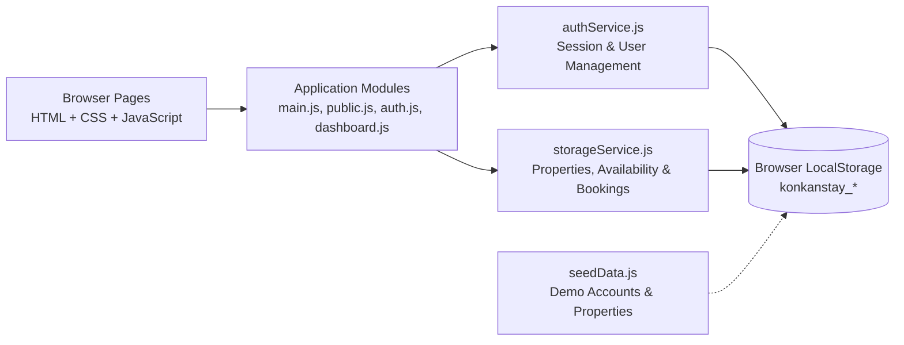

# KonkanStay Platform 🌊

A modern multi-page coastal-stay marketplace for the Konkan region of Maharashtra. KonkanStay runs entirely client-side using `localStorage` for all authentication, property listings, availability locking, and booking lifecycle management — with zero external backend or cloud dependencies.

> **Note:** Date availability, holds, payments, and booking confirmations are managed locally in the browser via `localStorage`. Seed accounts (host and customer) and sample Konkan properties are preloaded automatically on initial visit.

---

## ✨ Features

| Area | Description |
| --- | --- |
| **Discovery** | Destination landing page, property search, filters, sorting, interactive Konkan map, and property details |
| **Traveler Account** | Browser-local authentication, customer dashboard, saved properties, booking history, and printable confirmations |
| **Host Account** | Host dashboard, property listing creation, photo uploads, payment instructions, manual availability blocking, and booking review |
| **Booking Flow** | Per-property availability status, calendar date-overlap validation, holds, simulated payment workflow, and host approval flow |
| **Confirmation** | Instant booking confirmations with printable summary watermarking |
| **Responsive UI** | Fast, responsive HTML5, CSS3, and modern ES6 JavaScript bundled with Vite |

---

## 🧭 Pages and Routes

| Route | Audience | Purpose |
| --- | --- | --- |
| `/` (`index.html`) | Public | Landing page, destination highlights, featured stays, and search bar |
| `/pages/search/search.html` | Public | Explore listings, filter by location/price/amenities, view property details, and book |
| `/pages/login/login.html` | Public | Sign in to an existing traveler or host account (includes quick demo login buttons) |
| `/pages/register/register.html` | Public | Register as a traveler or host |
| `/pages/dashboard-customer/dashboard-customer.html` | Travelers | View booking history, interactive map of stays, and profile settings |
| `/pages/dashboard-host/dashboard-host.html` | Hosts | Add/manage property listings, block calendar dates, and approve/decline booking requests |

---

## 🏗️ Architecture



### Runtime Components

| Component | Responsibility | Location |
| --- | --- | --- |
| **UI Pages** | HTML templates and structure | `index.html`, [`pages/`](pages) |
| **Styles** | Responsive layouts, theme, and components | [`assets/css/`](assets/css) |
| **Auth Service** | Local user registration, login, hashing, and session management | [`assets/js/storage/authService.js`](assets/js/storage/authService.js) |
| **Storage Service** | Property CRUD, booking lifecycle, availability locks, and metrics | [`assets/js/storage/storageService.js`](assets/js/storage/storageService.js) |
| **LocalStorage DB** | Safe JSON wrapper and persistence utility | [`assets/js/storage/localStorageDb.js`](assets/js/storage/localStorageDb.js) |
| **Seed Data** | Initial demo users (host & customer) and verified Konkan listings | [`assets/js/storage/seedData.js`](assets/js/storage/seedData.js) |
| **Booking Helpers** | Calendar validation, date math, overlap checks, HTML escaping | [`assets/js/bookingUtils.mjs`](assets/js/bookingUtils.mjs) |

---

## 🗃️ LocalStorage Data Model

All data is stored in the browser's `localStorage` under isolated keys:

| Key | Contents | Description |
| --- | --- | --- |
| `konkanstay_users` | Array of User objects | Registered travelers and hosts (`id`, `email`, `role`, `name`, password hash) |
| `konkanstay_session` | Session object | Active user session (`id`, `email`, `role`, `name`) |
| `konkanstay_properties` | Array of Property objects | Listings with title, location, price, guests, amenities, host details, and photos |
| `konkanstay_bookings` | Array of Booking objects | Bookings with property details, customer info, check-in/out dates, status, and pricing |
| `konkanstay_availability` | Availability map | Locked/occupied dates per property to prevent conflicting reservations |

### Demo Accounts

The application automatically seeds standard test credentials for quick evaluation:

- **Host Account:** `host@konkanstay.com` / `password123`
- **Customer Account:** `customer@konkanstay.com` / `password123`

---

## 🚀 Local Setup

### Requirements
- **Node.js**: v20+ recommended
- **npm**: Bundled with Node.js

### Quick Start

1. Install dependencies:
   ```sh
   npm install
   ```

2. Start the development server:
   ```sh
   npm run dev
   ```

3. Open the URL shown in the terminal (usually `http://localhost:5173`).

---

## 🧰 Available Scripts

| Command | Description |
| --- | --- |
| `npm run dev` | Starts the Vite development server with hot reload |
| `npm run build` | Compiles and bundles all static pages and assets into `dist/` |
| `npm test` | Runs the test suite covering booking utilities and localStorage operations |
| `npm run test:storage` | Runs the localStorage database and auth unit test suite |

---

## 🧪 Testing

The platform includes full automated unit test coverage with Node.js built-in test runner:

```sh
npm test
```

This tests:
- Date calculation, range validation, and leap-year boundaries
- Safe financial totals and currency math
- HTML template escaping and sanitization
- Overlap detection and per-night exclusive locks
- User registration, login, and duplicate rejection
- Property creation, retrieval, and availability blocking
- Booking lifecycle transitions and conflict rejection

---

## 📦 Production Deployment

Run the build command:
```sh
npm run build
```

This compiles optimized bundles to `dist/`. The output contains standard static HTML, CSS, and JS files that can be deployed to any static host (e.g., GitHub Pages, Cloudflare Pages, Netlify, Vercel) without any backend server or database setup required.
